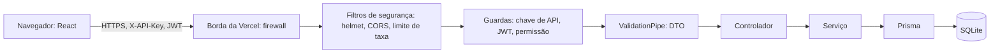

# Ciranda Web


Projeto da disciplina de Desenvolvimento Web (CEUB, Ciência da Computação, 2026). A Ciranda é um brechó online: quem tem roupa parada deixa a peça em consignação, e quem procura reserva, paga e acompanha o pedido. O repositório traz os cadastros pedidos na disciplina, com controle de acesso por perfil, e a loja inteira em volta deles.

| | |
| --- | --- |
| **Site no ar** | https://ciranda-web.vercel.app |
| **Documentação da API (Swagger)** | https://ciranda-web.vercel.app/api/docs |
| **Equipe** | Bruno Rodrigues dos Santos, Eduardo Clemente, Isaac Gomes de Moraes e Lucas Amaral Evangelista |
| **Contas de demonstração** | `lucia@ciranda.app` (Administradora), `beatriz@ciranda.app` (Fornecedor), `ana@ciranda.app` (Cliente). Senha `ciranda123`. Dados fictícios. |

## Sumário

1. [Resumo em números](#1-resumo-em-números)
2. [Tecnologias](#2-tecnologias)
3. [Como rodar](#3-como-rodar)
4. [O que foi pedido no trabalho e onde está](#4-o-que-foi-pedido-no-trabalho-e-onde-está)
5. [Padrão de back-end pedido em aula e onde está](#5-padrão-de-back-end-pedido-em-aula-e-onde-está)
6. [Skills do projeto](#6-skills-do-projeto)
7. [Arquitetura e estrutura de pastas](#7-arquitetura-e-estrutura-de-pastas)
8. [Banco de dados](#8-banco-de-dados)
9. [API](#9-api)
10. [Testes](#10-testes)
11. [Controle de acesso](#11-controle-de-acesso)
12. [Segurança](#12-segurança)
13. [A loja](#13-a-loja)
14. [A arara 3D](#14-a-arara-3d)
15. [Pipeline e publicação](#15-pipeline-e-publicação)
16. [Limites conhecidos](#16-limites-conhecidos)

## 1. Resumo em números

| O quê | Quanto |
| --- | --- |
| Testes do back-end | 106, com 100% das linhas cobertas |
| Testes do front-end | 109, com 100% das linhas cobertas |
| Testes de ponta a ponta (Cypress) | 30 |
| Cobertura mínima exigida | 80%. Abaixo disso o CI falha. |
| Rotas da API | 42, todas documentadas no Swagger |
| Tabelas do banco | 10, no padrão `tbl_NNN_nome` |
| CRUDs | 4: usuários, perfis, funcionalidades e peças |
| Módulos do NestJS | 12: um por recurso, mais núcleo, acesso, reservas e saúde |
| Vulnerabilidades no `npm audit` | 0 no back-end e 0 no front-end |

## 2. Tecnologias

| Camada | Tecnologia |
| --- | --- |
| Linguagens | TypeScript no back-end, JavaScript (JSX) no front-end, SQL nas migrations |
| Back-end | Node 22, NestJS 12 sobre Express 5 |
| Banco de dados | SQLite, acessado pelo Prisma 7 (ORM e migrations) |
| Validação | `ValidationPipe` do Nest com class-validator e class-transformer |
| Documentação da API | Swagger (OpenAPI), com `@nestjs/swagger` |
| Autenticação | JWT (HS256) no cabeçalho, cookie de sessão `HttpOnly`, senhas com bcrypt |
| Front-end | React 18 com Vite 8 e React Router 7 |
| Estilo | Tailwind CSS 3 e Materialize 2, com a paleta do CEUB |
| Testes de unidade e integração | Vitest 5, Supertest no back-end, Testing Library no front-end |
| Testes de ponta a ponta | Cypress |
| CI/CD | GitHub Actions para os testes e Vercel para a publicação |

## 3. Como rodar

Precisa do Node 22.13 ou mais novo. Funciona em macOS, Linux e Windows.

```bash
# terminal 1: API em http://localhost:3333, documentação em http://localhost:3333/api/docs
cd backend
npm install        # também gera o cliente do Prisma
npm run build
npm start

# terminal 2: site em http://localhost:5173
cd frontend
npm install
npm run dev
```

Sem configurar nada, a API sobe com um banco SQLite descartável, aplica as migrations e grava os dados de demonstração. Para guardar os dados em arquivo e usar os comandos do Prisma:

```bash
cd backend
cp .env.example .env                     # ajuste BANCO=dados/ciranda.db
npm run migrar:producao                  # prisma migrate deploy: cria as tabelas
npm run migrar -- --name minha_mudanca   # prisma migrate dev: cria uma migration nova
npm run migracoes:empacotar              # atualiza o SQL que a API aplica no banco descartável
```

Para ver tudo em cinco minutos: entre como Ana, abra uma peça, coloque na sacola, feche o pedido e confirme o Pix simulado. Em Vender, envie uma peça. Depois entre como Lúcia e abra Bastidores para aprovar a peça e mover o pedido.

## 4. O que foi pedido no trabalho e onde está

| Requisito | Onde está |
| --- | --- |
| Back-end separado no diretório | `backend/` (NestJS, Prisma, SQLite) |
| Front-end com framework à escolha | `frontend/` (React com Vite) |
| Tailwind CSS e Materialize | `frontend/tailwind.config.js` e `frontend/src/estilo.css` |
| Identidade visual do CEUB | Paleta oficial da Central da Marca em `frontend/tailwind.config.js` |
| CRUD 01: Usuário | `backend/src/usuarios/` e tela Usuários |
| CRUD 02: Perfil | `backend/src/perfis/` e tela Perfis |
| CRUD 03: Funcionalidades | `backend/src/funcionalidades/` e tela Funcionalidades |
| Cobertura de testes de 80% | Limite de 80% configurado nos dois `vitest.config`; o CI falha abaixo disso |
| Cypress | `frontend/cypress/e2e/` (30 testes de ponta a ponta, seção 10) |
| Mock, fixture, fake e stub | Mock em `frontend/src/api.test.js`, fixtures em `frontend/cypress/fixtures/`, fake em `frontend/src/teste/apiFalsa.js`, stub da arara em `frontend/cypress/e2e/03-simulado.cy.js` |
| GitHub Actions (CI/CD) | `.github/workflows/ci.yml` para os testes, e publicação automática na Vercel a cada push na `main` |
| Mobile | Layout responsivo, testado em 390 px no Cypress |
| Acessibilidade | Rótulos, foco visível, link de pular ao conteúdo, avisos com `role=status` e `role=alert` |
| CORS | `backend/src/comum/seguranca.ts`, lista de origens liberadas |
| Tokens | JWT de 30 minutos e sessão renovável por cookie, em `backend/src/auth/` |
| Chave de API | Cabeçalho `X-API-Key` exigido em toda rota de `/api` |
| CSP | Helmet na API e meta tag no `frontend/index.html` |
| Firewall de camada 7 e WAF | Firewall da Vercel na borda, com regra própria, mais o filtro de requisições e o limite de taxa em `backend/src/comum/seguranca.ts` |

Além dos três cadastros pedidos, há um quarto, de peças, que alimenta o catálogo.

## 5. Padrão de back-end pedido em aula e onde está

Cada item do slide "Criar skills" está no código e em uma das skills da seção 6.

| Item | Como foi feito | Onde está |
| --- | --- | --- |
| **Framework: NestJS** | API em NestJS com TypeScript: um módulo por recurso, cada um com controlador, serviço e DTOs em arquivos separados, mais guardas, interceptador e filtro de erros. | `backend/src/app.module.ts` e as pastas de `backend/src/` |
| **HTTP: métodos** | GET lê, POST cria ou executa ação, PUT substitui, DELETE remove. | Controladores em `backend/src/*/` |
| **HTTP: status codes** | 200, 201, 204, 400, 401, 403, 404, 409, 413, 429 e 500, cada um com um sentido só. | `backend/src/comum/erros.ts` e `filtro-de-erros.ts` |
| **HTTP: headers** | `X-API-Key`, `Authorization: Bearer`, cabeçalhos de segurança do helmet e de limite de taxa. | `backend/src/comum/seguranca.ts` |
| **HTTP: cookies** | Cookie de sessão `HttpOnly`, `Secure`, `SameSite=Strict`, restrito a `/api/auth`. | `backend/src/auth/auth.controller.ts` |
| **HTTP: CORS** | Lista de origens permitidas. Origem fora da lista recebe 403. | `corsRestrito` em `backend/src/comum/seguranca.ts` |
| **APIs REST com Swagger** | Documentação gerada do código, com corpo, respostas de sucesso e de erro (400, 401, 403, 404, 409, 429) e esquemas de segurança de cada rota. | https://ciranda-web.vercel.app/api/docs e `backend/src/app.ts` |
| **ORM e migrations: Prisma** | Todo acesso ao banco pelo cliente do Prisma. Mudança de banco só por migration. | `backend/prisma/schema.prisma` e `backend/prisma/migrations/` |
| **Padrão de tabelas** | `tbl` + número + nome: `tbl_001_usuarios` até `tbl_010_sessoes`. Um teste lê o banco e falha se alguma tabela fugir do padrão. | `backend/prisma/schema.prisma` e `backend/test/plataforma.test.js` |
| **OWASP: SQL injection** | Consultas parametrizadas pelo Prisma. Nenhum valor de requisição é colado em SQL. | `backend/src/banco/prisma.service.ts` |
| **OWASP: XSS** | API só devolve JSON com CSP `default-src 'none'`. O React escapa todo texto. Sessão longa em cookie `HttpOnly`. | `backend/src/comum/seguranca.ts` e `vercel.json` |
| **OWASP: CSRF** | Rotas de dados pedem JWT no cabeçalho, não cookie. Cookie `SameSite=Strict`, origem conferida e cabeçalho `X-API-Key` obrigatório. | Testes "CSRF" em `backend/test/plataforma.test.js` |
| **Hash de senhas** | bcrypt com custo 10. O hash nunca sai da API. | `backend/src/auth/auth.service.ts` e `backend/src/usuarios/usuarios.service.ts` |
| **Criptografia** | JWT assinado com HMAC SHA-256. Token de sessão aleatório de 32 bytes, guardado no banco só como SHA-256. | `backend/src/auth/auth.service.ts` |
| **HTTPS** | O site só responde por HTTPS, a API manda `Strict-Transport-Security` e o cookie sai com `Secure`. | `backend/src/comum/seguranca.ts` |
| **Validação de entrada** | `ValidationPipe` do Nest com class-validator: todo corpo e toda consulta passam por um DTO com regras de tipo, tamanho e formato. Campo que o DTO não declara é descartado. | `backend/src/comum/validacao.ts` e os arquivos `*.dto.ts` |
| **Gestão de segredos** | Segredos só em variável de ambiente. Em produção a API não sobe sem eles. | `backend/src/config.ts` e `backend/.env.example` |
| **JWT com o front** | JWT de 30 minutos no cabeçalho `Authorization`, renovado pelo cookie de sessão sem a pessoa perceber. | `backend/src/comum/guardas.ts` e `frontend/src/api.js` |

## 6. Skills do projeto

São duas skills, uma para cada coluna do slide da aula. Elas ficam em `.claude/skills/` e dizem como escrever e como revisar o projeto, sempre apontando o arquivo que serve de exemplo.

| Skill | O que cobre |
| --- | --- |
| [`arquitetura-backend`](.claude/skills/arquitetura-backend/SKILL.md) | NestJS (módulo, controlador, serviço, DTO), HTTP (métodos, status codes, headers, cookies, CORS), REST com Swagger, Prisma com migrations e padrão de tabelas `tbl_NNN_nome` |
| [`seguranca-boas-praticas`](.claude/skills/seguranca-boas-praticas/SKILL.md) | OWASP Top 10 (SQL injection, XSS, CSRF), hash de senhas, criptografia, HTTPS, validação de entrada, gestão de segredos e JWT com o front |

Cada skill termina com uma lista de conferência para usar antes de abrir um pull request.

## 7. Arquitetura e estrutura de pastas

O navegador fala só com a API. A API é a única que fala com o banco, sempre pelo Prisma.



No back-end, cada recurso tem a sua pasta com quatro arquivos: módulo, controlador, serviço e DTOs.

```
backend/
  prisma/
    schema.prisma            modelos e nomes das tabelas
    migrations/              SQL de cada mudança do banco
  src/
    main.ts                  sobe a API
    app.ts                   monta o Nest e o Swagger
    app.module.ts            módulo raiz: junta os módulos abaixo
    config.ts                lê os segredos do ambiente
    nucleo/                  módulo global: configuração e Prisma
    banco/                   PrismaService, dados de demonstração e migrations empacotadas
    comum/                   guardas, filtro de erros, validação, respostas do Swagger e segurança
    auth/                    login, cadastro, sessão por cookie e JWT
    usuarios/                CRUD 01   usuarios.module.ts, .controller.ts, .service.ts, .dto.ts
    perfis/                  CRUD 02   mesma estrutura
    funcionalidades/         CRUD 03   mesma estrutura
    pecas/                   CRUD de peças e catálogo
    sacola/                  sacola com reserva de 30 minutos
    pedidos/                 pedido, Pix simulado e linha do tempo
    consignacao/             envio, análise e repasse
    painel/                  impacto e bastidores
    reservas/                regras de reserva e interceptador que solta as vencidas
    saude/                   rota que diz se a API está no ar
  test/                      testes de integração (seção 10)
frontend/
  src/
    main.jsx, App.jsx        entrada e rotas
    api.js                   chamadas à API, com renovação do JWT
    sessao.jsx               quem está logado e o que pode ver
    menu.js                  itens do menu por funcionalidade
    paginas/                 Login, Cadastro, Catalogo, Peca, Loja, Vender, Bastidores e Cadastros
    componentes/             Layout, PaginaCrud, Campo, Arara, Festa e outros
    teste/                   API falsa em memória usada nos testes
    *.test.js(x)             testes de unidade e de tela (seção 10)
  cypress/
    e2e/                     testes de ponta a ponta
    fixtures/                respostas prontas em JSON
.claude/skills/              as duas skills do projeto
.github/workflows/ci.yml     pipeline do GitHub Actions
vercel.json                  publicação: site e API como dois serviços do mesmo projeto
```

## 8. Banco de dados

Toda tabela se chama `tbl` + número de três dígitos + nome no plural. As colunas ficam em minúsculas com `_`. No código, o Prisma usa nomes em português e liga cada modelo à sua tabela com `@@map` (`backend/prisma/schema.prisma`). Um teste lê o banco e falha se alguma tabela fugir do padrão.

| Tabela | Modelo no Prisma | O que guarda |
| --- | --- | --- |
| `tbl_001_usuarios` | `Usuario` | Nome, e-mail único, hash da senha, perfil e se está ativo |
| `tbl_002_perfis` | `Perfil` | Nome único e descrição |
| `tbl_003_funcionalidades` | `Funcionalidade` | Chave única no formato `area.acao`, nome e descrição |
| `tbl_004_perfis_funcionalidades` | `PerfilFuncionalidade` | Quais funcionalidades cada perfil tem |
| `tbl_005_pecas` | `Peca` | Título, marca, tamanho, categoria, conservação, preço, voltas, situação e dono |
| `tbl_006_sacola_itens` | `SacolaItem` | Peça reservada, por quem e até quando |
| `tbl_007_pedidos` | `Pedido` | Total, situação, código do Pix simulado, rastreio, pontos e impacto |
| `tbl_008_pedidos_itens` | `PedidoItem` | Peças de cada pedido, com o preço da época e o repasse |
| `tbl_009_pedidos_eventos` | `PedidoEvento` | Linha do tempo do pedido |
| `tbl_010_sessoes` | `Sessao` | SHA-256 do token de sessão e a validade |

Relações principais: um usuário tem um perfil, um perfil tem várias funcionalidades, um pedido tem itens e eventos, e uma peça pode ter um dono (consignação). Toda mudança de banco entra por uma migration em `backend/prisma/migrations/`.

## 9. API

A documentação completa, com corpo, exemplos e todas as respostas, está no Swagger: https://ciranda-web.vercel.app/api/docs. Para testar por lá: clique em Authorize, informe a chave de API, faça `POST /api/auth/login` e cole o token no campo `bearer`.

| Grupo | Rotas | Quem pode |
| --- | --- | --- |
| Saúde | `GET /api/saude` | Qualquer um. Única rota sem chave de API. |
| Acesso | `POST /api/auth/login`, `cadastro`, `renovar`, `sair` e `GET /api/auth/eu` | Chave de API |
| Usuários | `GET`, `POST /api/usuarios` e `GET`, `PUT`, `DELETE /api/usuarios/:id` | `usuarios.gerenciar` |
| Perfis | `GET`, `POST /api/perfis` e `GET`, `PUT`, `DELETE /api/perfis/:id` | `perfis.gerenciar` |
| Funcionalidades | `GET`, `POST /api/funcionalidades` e `GET`, `PUT`, `DELETE /api/funcionalidades/:id` | `funcionalidades.gerenciar` |
| Peças | `GET /api/pecas` e `GET /api/pecas/:id` | `catalogo.ver` |
| Peças | `POST /api/pecas` e `PUT`, `DELETE /api/pecas/:id` | `pecas.gerenciar` |
| Sacola | `GET`, `POST /api/sacola` e `DELETE /api/sacola/:pecaId` | `sacola.usar` |
| Pedidos | `GET`, `POST /api/pedidos`, `GET /api/pedidos/:id` e `POST /api/pedidos/:id/pagar`, `cancelar` | `sacola.usar` |
| Pedidos | `POST /api/pedidos/:id/avancar` | `bastidores.ver` |
| Consignação | `GET`, `POST /api/consignacoes` e `DELETE /api/consignacoes/:id` | `consignacao.publicar` |
| Consignação | `POST /api/consignacoes/:id/aprovar`, `recusar` | `consignacao.aprovar` |
| Painéis | `GET /api/impacto` e `GET /api/bastidores` | `sacola.usar` e `bastidores.ver` |

Status codes usados, cada um com um sentido só:

| Código | Quando |
| --- | --- |
| 200, 201, 204 | Deu certo: leitura ou ação, recurso criado, sem corpo |
| 400 | Dado inválido. O corpo traz a mensagem de cada campo em `detalhes`. |
| 401 | Falta a chave de API ou o token, ou eles não valem |
| 403 | O perfil não tem a funcionalidade, ou a origem não é permitida |
| 404 | Não existe, ou é de outra pessoa |
| 409 | Conflito com o estado atual: e-mail repetido, peça já reservada, perfil em uso |
| 413, 429 | Corpo maior que 100 kB, limite de requisições |
| 500 | Erro inesperado, sempre com mensagem genérica |

Toda resposta de erro tem o mesmo formato:

```json
{ "erro": "Dados inválidos.", "detalhes": { "email": "E-mail inválido.", "senha": "Mínimo de 8 caracteres." } }
```

## 10. Testes

### Como rodar

```bash
cd backend && npm test                        # 106 testes, com relatório de cobertura
cd frontend && npm test                       # 109 testes, com relatório de cobertura
cd frontend && npm run build && npm run e2e   # sobe a API e o site e roda os 30 testes do Cypress
```

O relatório detalhado de cobertura fica em `coverage/index.html` de cada pasta, e o CI guarda os dois como artefatos.

### Cobertura

| | Instruções | Ramos | Funções | Linhas | Mínimo exigido |
| --- | --- | --- | --- | --- | --- |
| Back-end | 99,6% | 96,6% | 99,6% | 100% | 80% (70% em ramos) |
| Front-end | 99,5% | 94,2% | 98,2% | 100% | 80% |

Os mínimos estão em `backend/vitest.config.js` e `frontend/vite.config.js`. Se a cobertura cair abaixo deles, `npm test` falha e o CI barra a mudança.

### Back-end: 106 testes de integração

Cada teste sobe a aplicação NestJS inteira com um banco novo e chama as rotas de verdade com o Supertest. Nenhum teste depende de outro.

| Arquivo | Testes | O que confere |
| --- | --- | --- |
| `backend/test/auth.test.js` | 7 | Login e autorização por funcionalidade |
| `backend/test/crud.test.js` | 17 | CRUD 01 usuários, CRUD 02 perfis, CRUD 03 funcionalidades e peças: criar, ler, editar, remover, conflitos e travas |
| `backend/test/loja.test.js` | 26 | Sacola com reserva de 30 minutos, pedido com Pix simulado, linha do tempo, consignação, bastidores, pontos, cadastro aberto e remoções em cascata |
| `backend/test/plataforma.test.js` | 24 | Padrão `tbl_NNN_nome`, migrations do Prisma, Swagger, cookie de sessão, CSRF e respostas de erro |
| `backend/test/seguranca.test.js` | 19 | Chave de API, CORS, cabeçalhos de segurança, tokens, filtro de camada 7, limites de taxa e configuração |
| `backend/test/validacao.test.js` | 9 | `ValidationPipe` com class-validator, 400 e 404 documentados no Swagger em toda rota, e a estrutura de um módulo por recurso |

### Front-end: 109 testes de unidade e de tela

As telas são montadas com a Testing Library e usadas como uma pessoa usaria: clicando, digitando e lendo o que aparece.

| Arquivo | Testes | O que confere |
| --- | --- | --- |
| `frontend/src/api.test.js` | 10 | Camada de API: cabeçalhos, erros e renovação do JWT |
| `frontend/src/app.test.jsx` | 15 | Entrada no sistema, menu por perfil, barra de cima, sessão e navegação |
| `frontend/src/cadastros.test.jsx` | 25 | Telas dos CRUDs de usuários, perfis, funcionalidades e peças, e o catálogo |
| `frontend/src/loja.test.jsx` | 38 | Sacola, pedido com Pix simulado, vender em consignação, bastidores e cadastro aberto |
| `frontend/src/peca.test.jsx` | 10 | Página da peça |
| `frontend/src/arara.test.jsx` | 11 | Modelos da arara, carregamento do pacote 3D e o componente |

### Ponta a ponta: 30 testes no Cypress

| Arquivo | Testes | O que confere | Contra o quê |
| --- | --- | --- | --- |
| `frontend/cypress/e2e/01-acesso.cy.js` | 6 | Acesso e perfis | API de verdade |
| `frontend/cypress/e2e/02-cruds.cy.js` | 6 | Os três CRUDs pedidos e o de peças | API de verdade |
| `frontend/cypress/e2e/03-simulado.cy.js` | 11 | Servidor fora do ar, sessão vencida, celular (390 px), teclado e arara 3D | API simulada com `cy.intercept` |
| `frontend/cypress/e2e/04-loja.cy.js` | 7 | A loja inteira, da conta nova ao repasse da consignação | API de verdade |

### Mock, fixture, fake e stub

| Dublê | O que é aqui | Onde está |
| --- | --- | --- |
| **Mock** | `vi.fn()` no lugar do `fetch`, para conferir cabeçalhos e chamadas | `frontend/src/api.test.js` |
| **Fake** | Uma API inteira em memória, com regras parecidas com as da real | `frontend/src/teste/apiFalsa.js` |
| **Fixture** | Respostas prontas em JSON que o Cypress entrega no lugar do servidor | `frontend/cypress/fixtures/` |
| **Stub** | O pacote 3D da arara trocado por um `cy.stub()`, para o teste não depender de placa de vídeo | `frontend/cypress/e2e/03-simulado.cy.js` |

## 11. Controle de acesso

Cada usuário tem um perfil, e cada perfil tem um conjunto de funcionalidades. O menu só mostra o que o perfil permite, e a API confere a permissão de novo a cada requisição, lendo o usuário no banco. Esconder o botão não basta: quem chamar a API direto também é barrado.

| Perfil | Conta de demonstração | Funcionalidades |
| --- | --- | --- |
| Administradora | lucia@ciranda.app | Todas as nove |
| Fornecedor | beatriz@ciranda.app | `catalogo.ver`, `pecas.gerenciar`, `sacola.usar`, `consignacao.publicar` |
| Cliente | ana@ciranda.app | `catalogo.ver`, `sacola.usar`, `consignacao.publicar` |

As nove funcionalidades: `catalogo.ver`, `pecas.gerenciar`, `usuarios.gerenciar`, `perfis.gerenciar`, `funcionalidades.gerenciar`, `sacola.usar`, `consignacao.publicar`, `consignacao.aprovar` e `bastidores.ver`. Perfis e funcionalidades novos podem ser criados pelas telas de cadastro.

## 12. Segurança

- **Chave de API:** toda rota de `/api` exige `X-API-Key`, comparada em tempo constante. A exceção é `/api/saude`.
- **Tokens:** login devolve um JWT assinado, válido por 30 minutos, e grava um cookie `HttpOnly` de sessão, de uso único, que renova o JWT. A senha fica guardada com bcrypt.
- **CSRF:** as rotas de dados não aceitam cookie. O cookie é `SameSite=Strict`, só vale em `/api/auth`, e requisição de origem fora da lista recebe 403.
- **CORS:** só as origens em `CORS_ORIGENS` são aceitas.
- **CSP:** a API responde com `default-src 'none'`, e o site restringe scripts, estilos, imagens e conexões à própria origem.
- **Camada 7:** limite de requisições por minuto (mais apertado no login), corpo limitado a 100 kB e um filtro que recusa padrões conhecidos de ataque na URL e no corpo.
- **SQL:** todo acesso ao banco passa pelo Prisma, que parametriza as consultas.
- **Dados de cada pessoa:** sacola, pedidos e peças em consignação são filtrados pelo dono no servidor. Pedido de outra pessoa responde 404, para não revelar que o número existe.

## 13. A loja

Tudo o que o Ciranda original fazia, agora com servidor, permissão por funcionalidade e testes:

| Função | Como funciona | Onde está |
| --- | --- | --- |
| Cadastro aberto | Qualquer pessoa cria conta e entra sempre como Cliente. O perfil nunca vem do formulário. | `backend/src/auth/`, tela Criar conta |
| Sacola com reserva | Colocar na sacola reserva a peça por 30 minutos. Duas pessoas não reservam a mesma peça, e a reserva vencida volta sozinha ao catálogo. | `backend/src/sacola/`, `backend/src/reservas/` |
| Pix simulado | Fechar a sacola gera um pedido com código Pix de mentira e prazo. Um botão faz o papel do banco e abre a tela de comprado, com confetes e o que a compra poupou. Nenhum dinheiro circula. | `backend/src/pedidos/`, tela do pedido |
| Pedidos e rastreio | Linha do tempo de Pago a Entregue, com histórico e código de rastreio simulado. Cada pessoa vê só os próprios pedidos. | `backend/src/pedidos/` |
| Consignação | A pessoa envia a peça, o brechó aprova ou recusa com motivo, e a venda gera repasse de 60% para quem enviou. | `backend/src/consignacao/`, telas Vender e Bastidores |
| Impacto e pontos | Cada peça mostra a água e o carbono que poupa. Cada compra paga soma pontos. Categoria sem fator confiável não mostra número. | `backend/src/comum/impacto.ts`, `frontend/src/impacto.js` |
| Bastidores | Vendido, a repassar, fila de consignação e pedidos para mover de etapa. | `backend/src/painel/`, tela Bastidores |

## 14. A arara 3D

No topo do catálogo, as peças de cima (camiseta, camisa, moletom e jaqueta) ficam penduradas em uma arara 3D que gira com o mouse ou o dedo. Escolher uma peça, na arara ou na lista, abre a página dela, onde a peça gira em 3D e mostra marca, tamanho, conservação, número de voltas e a estimativa de água e carbono que aquela volta poupa (fatores em `frontend/src/impacto.js`, os mesmos do Ciranda original). O pacote 3D só é baixado quando o catálogo abre, e em aparelho sem WebGL a arara some e a lista continua inteira, então nada depende dela para funcionar.

Cada tecido tem a sua trama: malha nas camisetas e moletons, tela no linho das camisas e sarja no jeans das jaquetas. O pano atrasa, balança e assenta quando a peça gira.

O código que liga a arara ao catálogo está em `frontend/src/arara.js` e `frontend/src/componentes/Arara.jsx`. O pacote compilado fica em `frontend/public/arara3d/`.

## 15. Pipeline e publicação

A cada push ou pull request, o GitHub Actions (`.github/workflows/ci.yml`) roda quatro etapas:

| Etapa | O que faz |
| --- | --- |
| Back-end | Confere o esquema do Prisma, roda os testes com a cobertura mínima e compila a API |
| Front-end | Roda os testes com a cobertura mínima e gera o build |
| Ponta a ponta | Sobe a API e o site e roda o Cypress. Só começa se as duas anteriores passarem. |
| Pacote para deploy | Na `main`, guarda o build do site como artefato |

A cada push na `main`, a Vercel publica o site e a API em https://ciranda-web.vercel.app. Os segredos de produção (segredo do token e chave de API) ficam nas variáveis de ambiente da Vercel, fora do repositório.

## 16. Limites conhecidos

1. São duas camadas. Na borda, o firewall da Vercel faz a mitigação automática de ataques de volume e aplica uma regra nossa, que nega caminhos típicos de varredura (`/.env`, `/.git`, `/wp-admin` e parecidos) antes de chegarem ao site. Dentro da aplicação, o filtro de requisições é um complemento, não um substituto.
2. Em produção o banco é um SQLite descartável: os dados de demonstração voltam ao estado inicial quando a hospedagem reinicia a API. Como o acesso é todo pelo Prisma, trocar por um banco gerenciado é mudar o `provider` do esquema e o adaptador.
3. Chave de API em um site que roda no navegador não é segredo, porque qualquer pessoa consegue ler. Ela identifica o cliente autorizado; quem protege os dados é o token.
4. As cores são as da Central da Marca do CEUB (roxo escuro `#43054E`, roxo `#662C92`, lilás `#BF0087`, magenta `#EC0089` e amarelo `#FDE100`). O logotipo da instituição não é usado.
5. A arara e os modelos de camiseta, moletom e camisa vêm do componente Clothes Rack, de DiMaac UI. A página do componente não informa a licença, então o repositório traz só o pacote compilado, sem o código-fonte dele.
